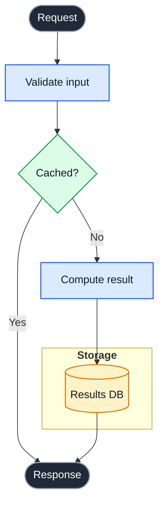

# Mermaid Diagrams

Every diagram in this repo's Markdown is a Mermaid code block. Do not draw diagrams with ASCII characters. Directory trees in a plain code block are not diagrams and stay as they are.

Follow these rules strictly so the diagram renders cleanly in both GitHub light and dark modes.

## 1. Diagram type and direction

- Use `flowchart TD`. Use `flowchart LR` only for short, linear flows.
- Keep the diagram between 6 and 12 nodes. If it needs more, merge detail into a node's second line or split it into two diagrams.

## 2. High-contrast colors

- Do not rely on Mermaid's default theme colors. They wash out in GitHub dark mode.
- Define 3 or 4 `classDef` styles with muted fills, crisp borders and an explicit text color: `#ffffff` on dark fills, `#111827` on pastel fills.
- Assign every node a class. Use the same class for the same kind of thing throughout a diagram.

Default palette, to keep diagrams consistent across docs. Rename the classes to fit the diagram:

```
classDef entry fill:#1f2937,stroke:#9ca3af,stroke-width:1.5px,color:#ffffff
classDef primary fill:#dbeafe,stroke:#2563eb,stroke-width:1.5px,color:#111827
classDef secondary fill:#dcfce7,stroke:#16a34a,stroke-width:1.5px,color:#111827
classDef external fill:#fef3c7,stroke:#d97706,stroke-width:1.5px,color:#111827
```

## 3. Typography and labels

- Keep node text to 2-4 words per line. Break lines with `<br/>`.
- Wrap every node label in double quotes, for example `["Label"]`, so special characters cannot break the syntax.
- Use shapes for meaning:

| Shape | Syntax | Meaning |
|-------|--------|---------|
| Rounded rectangle | `(["Start or end"])` | Entry and exit points |
| Rectangle | `["Process"]` | Actions |
| Diamond | `{"Decision?"}` | Branching |
| Cylinder | `[("Database")]` | Storage |

## 4. Layout and grouping

- Group related components in `subgraph` blocks with clear, bold titles: `subgraph ID["<b>Title</b>"]`.
- Avoid crossing lines: define nodes in the order they appear, top to bottom or left to right.
- Label conditional or typed arrows, for example `-->|Yes|` or `-->|Async|`.

## 5. Placement in a document

- Put the diagram in a `mermaid` code block, followed directly by a brief two-sentence explanation of what it shows.
- Do not repeat in prose what the diagram already makes obvious.

## Example



A request is answered from the cache when possible and computed otherwise. Computed results are stored before the response is returned.

## Checklist before finishing

- 6-12 nodes, `flowchart TD` or `LR`.
- Every label in double quotes, no line longer than 4 words.
- 3-4 `classDef` styles with explicit `color`, and every node has a class.
- Subgraph titles are bold, and no lines cross.
- A two-sentence explanation follows the block.
