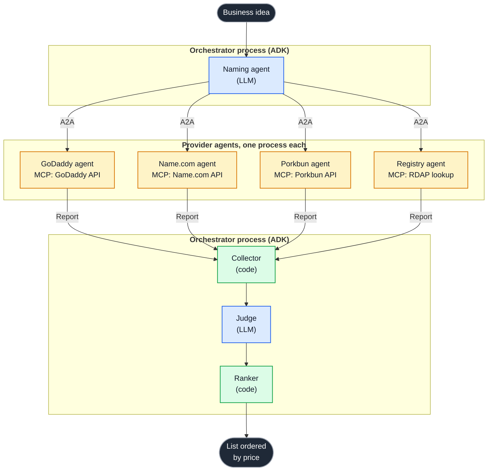

# Design: Domain Name Research

## Overview

A rough business description goes in, and a price-ordered list of purchasable domain names comes out.

The naming agent's candidates go to four provider agents at the same time over A2A, and each provider agent reaches its provider through an MCP tool. Their reports are validated, judged and ranked back in the orchestrator, which is one process shown in two parts to keep the flow top to bottom.

Three standards are used, each for one kind of communication:

| Layer | Standard | Used for | Code |
|-------|----------|----------|------|
| Inside one process | ADK (Agent Development Kit) | Running the steps in order, running the provider checks in parallel, sharing state between steps | `pipeline.py` |
| Between agents | A2A (Agent2Agent) | The orchestrator calling each provider agent over HTTP. Each provider agent publishes an agent card at `/.well-known/agent-card.json` | `provider_agent.py`, `RemoteA2aAgent` in `pipeline.py` |
| Agent to tool | MCP (Model Context Protocol) | A provider agent calling its provider's `check_domains` tool | `mcp_server.py`, `providers.py` |

## Agents

| Agent | Role | Model | Tools |
|-------|------|-------|-------|
| `naming_agent` | Proposes candidate domains that follow the naming guidelines | `claude-opus-5-5` | None |
| `<provider>_provider_agent` (one per provider) | Receives the candidate list over A2A, calls its lookup tool, returns a report | `claude-opus-5-5` | `check_domains` over MCP |
| `collector` | Validates the provider reports and fills gaps with `unknown` | None (code) | None |
| `judge` | Gives a keep or drop verdict per domain, with a reason and flags | `claude-opus-5-5` | None |
| `ranker` | Applies the hard rules and sorts by price | None (code) | None |

The model is set in one place (`config.py`) and can be changed with `DOMAIN_RESEARCH_MODEL`.

### Providers

| Provider | Source | Credentials | Returns |
|----------|--------|-------------|---------|
| `godaddy` | GoDaddy Domains API v3 | `GODADDY_PAT` | Availability, first-year and renewal price |
| `namecom` | Name.com Core API | `NAMECOM_USERNAME`, `NAMECOM_TOKEN` | Availability, first-year and renewal price, premium flag |
| `porkbun` | Porkbun API v3 | `PORKBUN_API_KEY`, `PORKBUN_SECRET_KEY` | Availability, first-year and renewal price, premium and promo flags |
| `registry` | Public RDAP lookup | None | Registration status only, no price |

The `registry` agent is not a seller. It is there so a run gives real availability with no provider credentials, and so the judge has an independent check on what the sellers report.

Adding a provider means adding one lookup function and one entry in `providers.py`, plus a port in `config.py`. Nothing else changes.

## Naming guidelines

The naming agent follows these when proposing candidates:

- **Easy to memorize**: short, few syllables, nothing that needs explaining.
- **Respelled words**: a name may sound like a real word but be written differently, which often makes it available where the dictionary spelling is taken.
- **Easy to say and type**: someone who hears the name once should be able to type it. No hyphens or digits.
- **Fits the business**: the name suggests what the business does or how it should feel.

The guidelines live in `NAMING_INSTRUCTION` in `pipeline.py`.

## Coordination

Every hand-off is a typed message defined in `schemas.py`:

| From | To | Message |
|------|----|---------|
| Naming agent | Session state | `CandidateList`: domain, guideline, reasoning |
| Orchestrator | Provider agent (A2A) | The list of domains, as JSON |
| Provider agent | Orchestrator (A2A) | `ProviderReport`: one `Quote` per domain with status, price, renewal price, premium flag and a note |
| Judge | Session state | `VerdictList`: keep, reason and flags per domain |
| Ranker | Caller | `FinalList`: ranked domains and dropped domains |

Rules that keep the result trustworthy:

- **Models decide, code handles numbers.** A provider agent's model decides how to call the tool, and the report it sends back is copied from the tool result by code. The judge gives verdicts and never restates a price. Sorting is done in code.
- **Unknown is a valid answer.** A lookup that fails, a missing credential, or a provider agent that is down all produce `unknown` with a note. Nothing is guessed, and one failing provider does not stop the run.
- **Hard rules are enforced in code.** A domain that any provider reports as taken is dropped, whatever the judge says. A domain with no confirmed availability is dropped.
- **Lookups retry.** Rate limits and server errors are retried up to three times.

The final list is ordered by first-year price from the cheapest provider, with the renewal price and the other providers' prices beside it. Domains that are unregistered but have no price come last, with a flag.

## Evaluation

The run is a success if the list can be trusted without rechecking each entry:

- **Availability accuracy**: every domain on the list is checked by hand at the listed provider. The share that can actually be added to a cart is the headline number.
- **Price accuracy**: the share of entries whose listed price matches the price shown at checkout.
- **Coverage**: the share of candidate and provider pairs that got a real answer, not `unknown`.
- **Name quality**: a human rates each listed name 1-5 against the naming guidelines.
- **Cost**: total tokens and wall-clock time.

Automated tests cover the ranking rules, the parsing of each provider's response format, and an end-to-end run with a scripted model in which one provider agent is down.

## Open questions

- **Workflow migration.** `SequentialAgent` and `ParallelAgent` still work in ADK 2.14 but are marked deprecated in favor of the graph-based `Workflow`. The pipeline should move to it.
- **Structured output with Claude.** ADK asks Claude for structured output through a tool call. This has only been exercised with the scripted model, so the first real run needs watching.
- **Provider response formats.** The GoDaddy and Name.com parsers were written from the API documentation and tested against made-up responses, not against live accounts. GoDaddy's price unit (cents) is taken from its docs.
- **Premium and aftermarket listings.** A seller may show a registered domain as available for resale. The hard rule currently drops it because the registry reports it taken.
- **Cost.** Every agent uses the same top-tier model. The provider agents do little reasoning and are candidates for a cheaper one.
- **A second round.** The judge cannot yet send feedback to the naming agent when too few candidates survive.
- **Tracing.** Events are saved as JSON lines. ADK also supports OpenTelemetry, which is not set up.
