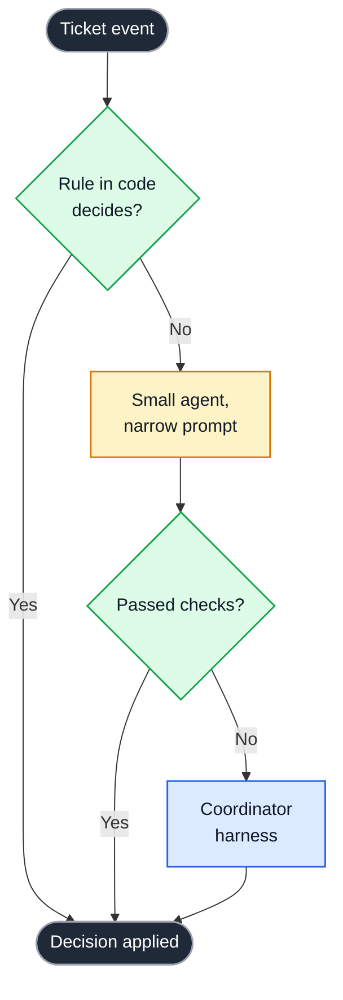

# Cost: H2H

Multi-harness systems have a reputation for being expensive. This document lists where the cost comes from and what H2H does about each source. It is a design constraint from the start, not something to tune later.

## Where the cost comes from

Based on write-ups about existing tools (see [prior-art.md](prior-art.md)) and on how harnesses work:

| Source | Why it is expensive |
|---|---|
| Many full sessions | A harness sends its working context to the model on every step. Many sessions in parallel multiply that |
| Cold starts | Every new harness has to read the codebase before it can work |
| Coordination done by harnesses | Reading tickets, checking on workers and re-planning use tokens without producing work |
| Idle sessions | Agents that wait or poll still make model calls |
| Rework | Parallel agents duplicate or undo each other's work, and fixes are paid for again |
| Top-tier models everywhere | The most capable models cost the most per token |

## What H2H does about each

### One owner per domain

A domain has exactly one harness. Parallel work inside the domain is that harness's own business, through its sub-agents.

- **Why it is cheaper:** the owner already holds the map of its domain and hands each sub-agent a narrow brief. A second full harness would have to build that map itself.
- **What is given up:** sub-agents are invisible to H2H. It sees the owner's reports and total spend.
- **When one harness is not enough:** the domain is too big. Split it into two domains with separate owners, never two harnesses sharing one.

### Domain map

Each owner keeps a short written map of its domain in its workspace: structure, conventions and decisions made. A new or resumed session reads the map instead of the codebase.

### Three tiers of coordination

Every coordination decision is tried at the cheapest tier first and moves up only when that tier cannot decide. The coordinator harness is the last resort, not the default.

| Tier | Handles | Cost |
|---|---|---|
| Rules in code | Ticket states, approvals, budgets, ownership checks, dependency order | None |
| Small agents with narrow prompts | Routing a ticket to a domain, checking that a report is complete, summarising status, project manager judgment calls | Low: a cheap model and a short context |
| Coordinator harness | Planning from a brief, re-planning when owners are stuck | High, used rarely |

- **Escalation is explicit.** A small agent hands off on a defined signal, such as a failed validation or two unsuccessful attempts. It does not decide by its own judgment.
- **The framework is secondary.** The small agents can be built with an agent framework such as ADK or as plain model calls with typed output.

### Event-driven coordination

Coordination runs when a ticket changes state. Nothing sits in a loop asking whether there is work.

### No idle sessions

An owner with no open ticket is stopped and resumed later by session ID, with its domain map to pick up from.

### Rework prevention

Rework is prevented by mechanisms in code, not by instructions alone. See [governance.md](governance.md).

### Model and effort chosen by the user

The config sets the model and effort level per domain and per phase of work: investigation, research, planning and execution.

- **Phases are separate tickets.** Not every harness can change model or effort inside a session, and doing so can discard cached context. Each phase ticket starts with its own settings.
- **The ticket carries the intended settings,** and each harness's pool entry translates them into what that harness supports.

### Budgets

Budgets exist per harness and, in managed mode, per sprint. See [planning.md](planning.md).

Each harness reports usage in its own unit: Claude Code in dollars and tokens, Codex in tokens, Copilot in AI credits. A budget is therefore kept per harness in that harness's unit, unless the config gives a conversion.

## What the baseline validation showed

One small task was done by one harness using sub-agents and by a builder and a tester in separate sessions. Details are in [findings.md](findings.md).

- **The handoff itself was not expensive.** Two Claude sessions cost $0.023 to $0.025, against $0.028 to $0.048 for one session with sub-agents.
- **Testing cost as much as building**, or up to twice as much.
- **A rework round roughly doubled the builder's cost.** Rework is recorded as a cost of its own per ticket.
- **So the independent test is a setting.** The builder always checks its own work. Whether a second harness also tests it is chosen per ticket type, because it can double the cost of a ticket; see [governance.md](governance.md).

This was two sessions on an easy task. The cost reported for existing tools comes from coordinating many agents, which was not tested.

## Data recorded from the first version

Every ticket records phase, model, effort, tokens used, rounds, and whether the work was approved or rejected. This is cheap to record and impossible to reconstruct later. It is what the retro report, the budget choices and any later automation depend on.

## Later: automatic settings

Once enough data exists, H2H can suggest and then set the model and effort for a kind of task based on how similar tasks went. This starts as suggestions and goes through plan and apply before anything changes by itself.
