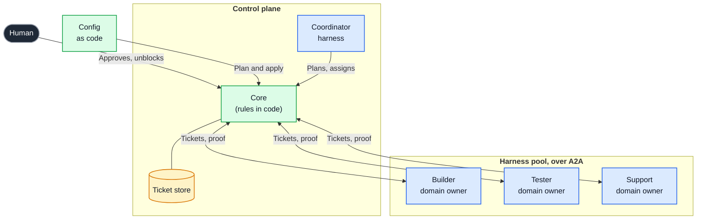

# Design: H2H

## Overview

H2H lets harnesses work as a team. Each harness owns a domain, plans its own work inside it, and reports what is done and what is left. A fixed core holds the rules, and a human stays in the loop through a ticket system.

The core enforces the rules and records everything in the ticket store, while harnesses do the planning and the work. The human and the config both act on the core, never directly on a harness.

## Core ideas

### Harness, not model

Orchestration frameworks such as ADK run agents that you define inside the framework. A harness is a finished product with its own loop, tools, permissions and sub-agent spawning. H2H treats each harness as an opaque service: it receives work and returns status and results, and what happens inside is its own business.

### Domain owner, not task worker

| | Task worker (experiment 01) | Domain owner (H2H) |
|---|---|---|
| Scope | One request | An area, such as UI testing or customer service |
| Memory | None between calls | Keeps its own history and decisions |
| Planning | Done by the orchestrator | Done inside the harness |
| Reports | A result | What is done and what is left |
| Orchestrator's job | Directs every step | Coordinates between owners |

This difference comes from how the harness is used, not from the protocol. A2A only defines how work is handed over and how status comes back.

### Harness-agnostic

The rest of the system never depends on which product a harness is. Consequences:

- The same harness can appear twice in a team, as two sessions with separate histories.
- A harness with a different strength or budget can be added later as a new pool entry.
- Swapping the harness behind a role should touch only that harness's wrapper.

## Components

### Harness wrapper

Each harness sits behind a wrapper that exposes it as an A2A service and runs it through its SDK or headless mode. The wrapper is responsible for:

- Translating a ticket into work for the harness, and the harness's output into a typed result.
- Forwarding progress so the status view has something to show. Internal sub-agents are visible only if the wrapper forwards them.
- Enforcing the budget, because the core cannot see what an opaque harness spends until it reports.
- Reporting whether the harness is logged in and able to run.

Wrappers hold more logic than "thin" suggests. Anything specific to one harness, such as its permission modes, stays here as configuration.

### Harness pool

A registry of available harnesses. A2A describes a single agent through its agent card, including its skills. It does not define a list of agents, so the pool is ours to build. Each entry records the card URL, the role, the budget and whether the harness is busy.

### Core

The part that must be exact and is therefore code, not a model:

- Ticket states and the transitions between them.
- Approval rules by ticket type.
- Budgets.
- Which owner may use which credentials.

### Coordinator harness

Optional, and added after the core works. A harness with the role "coordinator" that:

- Breaks a project brief into tickets and assigns them to owners.
- Re-plans after rejections or when owners block each other.
- Summarises status for the human.

It is a pool member like any other, so it can be swapped. Its limits are in [governance.md](governance.md).

### Status view

Side-by-side status of every harness, fed by the state and progress messages each A2A task streams back.

## Communication model

### Contract between core and harness

The shared contract is deliberately small, because the core can only rely on what every harness supports:

| Message | Contents |
|---|---|
| Work request | Ticket reference, description, acceptance criteria, workspace reference, budget |
| Status update | State (working, needs input, needs authentication, done, failed) and a progress note |
| Result | Typed per role. Builder: commit reference and summary. Tester: pass or fail, and the list of failures. All roles: proof |

Results are typed and identical for every holder of a role. If each harness answered in free text, the core would need per-harness parsing and the agnosticism would be lost.

### Sessions and isolation

- Each harness instance has its own session, so two instances of one product do not share history.
- Each instance has its own working copy, for example a git worktree. Two instances in one directory will collide.

### Handing work between owners

Code moves between owners through version control: the builder commits, and the tester checks out that commit. The commit reference travels in the message. A2A does not define a shared workspace.

## Example: build and test a UI

1. A ticket asks for a UI feature. The builder owner implements it and attaches a commit and a summary.
2. A test ticket goes to the tester owner with the commit reference and the acceptance criteria.
3. The tester starts the app, drives the UI and returns pass or fail with the failures listed.
4. Failures go back to the builder as a rejection with reasons. The loop repeats until tests pass or a round limit is reached.
5. Depending on the approval rules, the result is accepted automatically or waits for the human.

The tester needs a running app and a browser it can drive, which is more setup than the builder side.

## Known limits of the approach

- **Opacity:** work inside a harness cannot be seen or capped from outside beyond what its wrapper reports.
- **Lowest common denominator:** only features every harness supports can be part of the shared contract.
- **Persistence:** an owner that holds a domain for weeks needs memory beyond one session, and each harness handles that differently.
- **Boundaries:** when one domain needs a change in another, the owners need an agreed interface for requesting it.
