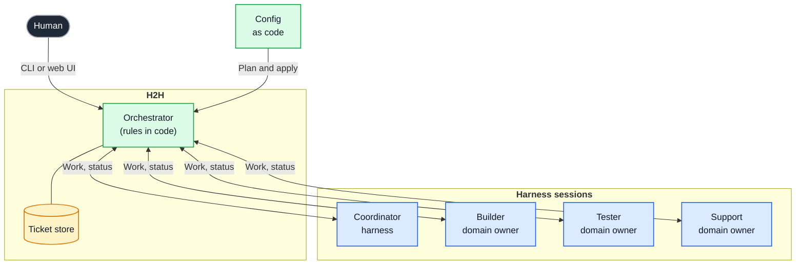
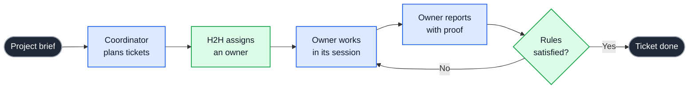

# Design: H2H

## Overview

H2H lets harnesses work as a team. Each harness owns a domain, plans its own work inside it, and reports what is done and what is left. H2H supervises the harnesses, holds the rules, and keeps a human in the loop through a ticket system.

The orchestrator enforces the rules and records everything in the ticket store, while harnesses do the planning and the work. The human acts through the orchestrator and can also watch or step into any harness session directly.

## How work flows

A brief becomes tickets, each ticket goes to a domain owner, and the owner's report is checked against the rules before the ticket closes. The check covers proof and, where required, human approval; [governance.md](governance.md) shows it in full.

## Core ideas

### Harness, not model

Orchestration frameworks such as ADK run agents that you define inside the framework. A harness is a finished product with its own loop, tools, permissions and sub-agent spawning. H2H treats each harness as opaque: it receives work and reports status and results, and what happens inside is its own business.

### Domain owner, not task worker

| | Task worker (experiment 01) | Domain owner (H2H) |
|---|---|---|
| Scope | One request | An area, such as UI testing or customer service |
| Memory | None between calls | Keeps its own history and decisions |
| Planning | Done by the orchestrator | Done inside the harness |
| Reports | A result | What is done and what is left |
| Orchestrator's job | Directs every step | Coordinates between owners |

### Harness-agnostic

The rest of the system never depends on which product a harness is. To join a team, a harness only has to run in a terminal and be able to call a tool. Consequences:

- The same harness can appear twice in a team, as two sessions with separate histories.
- A harness with a different strength or budget can be added later as a new pool entry.
- Swapping the harness behind a role should need only a change to that pool entry.

### One owner per domain

A domain has exactly one harness. Parallel work inside the domain is handled by that harness's own sub-agents. If a domain needs a second harness, the domain is split in two. The reasons are in [cost.md](cost.md).

### Supervisor, not only coordinator

H2H owns each harness as a running process: its workspace, session and logs. The user can list active harnesses, follow their logs, and jump into one. Sessions survive a crash of H2H itself. [runtime.md](runtime.md) covers this.

## Components

### Orchestrator

The part that must be exact and is therefore code, not a model:

- Ticket states and the transitions between them.
- Approval rules by ticket type.
- Budgets.
- Which owner may use which credentials.

It also starts sessions, serves the CLI and web UI, and recovers running sessions when it restarts.

### Harness session and keeper

Each harness runs in its own session under a small keeper process that holds its terminal and records its state. Details are in [runtime.md](runtime.md).

### Reporting tool

A tool H2H gives every harness, as an `h2h` command or an MCP server. The harness calls it to fetch its tickets, report progress, attach proof, or say it is blocked. This is how status reaches H2H; the terminal is never parsed.

### Harness pool

The registry of harnesses a team can use. Each entry records how to start the harness, its role, its budget and its launch settings. Anything specific to one product, such as its permission modes, lives in its pool entry.

### Coordinator harness

Optional, added after the rest works, and used only when code and small agents cannot decide. A harness with the role "coordinator" that:

- Breaks a project brief into tickets and proposes owners for them.
- Re-plans after rejections or when owners block each other.
- Summarises status for the human.

It is a pool member like any other, so it can be swapped. Its limits are in [governance.md](governance.md).

### Small coordination agents

Routing, completeness checks and status summaries are done by small agents with narrow prompts and cheap models, between the rules in code and the coordinator harness. See [cost.md](cost.md).

### Project manager

Optional. Adds estimation, grooming and sprints on top of the default kanban flow. See [planning.md](planning.md).

### Status view

Side-by-side status of every session, from the ticket store and the keepers' state, with the option to open any session's terminal.

## Communication model

### Local harnesses

| Direction | Channel |
|---|---|
| Work into the harness | The prompt at session start, and occasionally text typed into its terminal |
| Status out of the harness | The reporting tool |
| People | The session's terminal |

### Remote harnesses

A harness on another machine cannot be reached through a local terminal. For that case the harness sits behind a wrapper that exposes it as an A2A service, and H2H calls it over the network. A2A treats an agent as an opaque service with task states and streamed progress, which is the same contract seen from the other side. Remote harnesses are not part of the first versions.

### Contract

The shared contract is deliberately small, because H2H can only rely on what every harness supports:

| Message | Contents |
|---|---|
| Work request | Ticket reference, description, acceptance criteria, workspace, budget |
| Status report | State (working, needs input, needs authentication, done, failed) and a progress note |
| Result | Typed per role. Builder: commit reference and summary. Tester: pass or fail, and the list of failures. All roles: proof |

Results are typed and identical for every holder of a role. If each harness answered in free text, H2H would need per-harness parsing and the agnosticism would be lost.

### Handing work between owners

Code moves between owners through version control: the builder commits, and the tester checks out that commit in its own workspace. The commit reference travels on the ticket.

## Example: build and test a UI

1. A ticket asks for a UI feature. The builder owner implements it and reports a commit and a summary.
2. A test ticket goes to the tester owner with the commit reference and the acceptance criteria.
3. The tester starts the app, drives the UI and reports pass or fail with the failures listed.
4. Failures go back to the builder as a rejection with reasons. The loop repeats until tests pass or a round limit is reached.
5. Depending on the approval rules, the result is accepted automatically or waits for the human.

At any point the user can open either session's terminal to watch or step in. The tester needs a running app and a browser it can drive, which is more setup than the builder side.

## Known limits of the approach

- **Opacity:** H2H knows what a harness reports and what its terminal shows. It cannot cap what the harness does internally beyond stopping the session.
- **Lowest common denominator:** only features every harness supports can be part of the shared contract.
- **Reporting depends on the harness.** A harness that forgets to call the reporting tool looks idle. Its instructions and the round limits have to account for that.
- **Persistence:** an owner that holds a domain for weeks needs memory beyond one session, and each harness handles that differently.
- **Boundaries:** when one domain needs a change in another, the owners need an agreed interface for requesting it.
