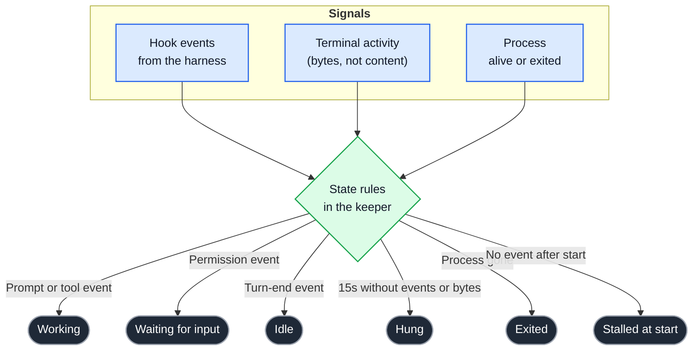

# Findings: H2H

Results of the three validation spikes run before any build, on 2026-11-20. The code and the full write-up of each spike are under [`../validations/`](../validations/README.md). This document records what was tested, in enough detail to judge the results, and what the results change in the design.

## Summary

| Spike | Question | Result |
|---|---|---|
| 01 Session state | Can H2H tell a harness's state without reading its screen? | Yes, for all three harnesses, from their own hooks |
| 02 Permission policy | Can a permission request be answered in code? | Yes, for all three, with no prompt reaching the screen |
| 03 Baseline | Do two sessions cost more than one harness with sub-agents? | Not on a small task. A tester from another product found defects nothing else did |

None of the three invalidated the design. Each one changed a part of it, listed under [What changes in the design](#what-changes-in-the-design).

## Test setup

| Item | Value |
|---|---|
| Machine | One macOS laptop |
| Claude Code | 2.1.329, model Haiku 5.5, on the user's subscription login |
| GitHub Copilot CLI | 1.0.114, automatic model selection |
| Codex CLI | 0.171.0, default model |
| Gemini CLI | Excluded. It no longer offers a personal login |
| Spike code | Python, standard library only. Throwaway, not the start of H2H |
| Workspaces | A fresh folder per run, inside this repository |

Each harness ran on the login already present on the machine. Nothing was mocked: every run made real model calls.

## Spike 01: session state

### What was built

A keeper script that starts one harness in a pseudo-terminal and works out its state from four signals. The terminal's content is never inspected.

The keeper combines the harness's own hook events with whether the terminal is producing any bytes and whether the process is alive. Hooks decide most states, and silence is only used to detect a hang or a start that never happened.

A fourth signal, the harness calling a reporting command (`h2h-report`), was recorded to see whether harnesses do it when told to. It was not used to decide state.

### Scenarios and checks

Each scenario was run once per harness in the final version of the keeper, after earlier runs used to get the setup right.

**`complete`: a task that finishes, then a second task typed in.**

The harness is started with the prompt "create hello.txt containing the word hi, then run `h2h-report done first-task`". When the keeper sees the turn end, it types a second prompt into the terminal (append a line, report again), and then types `/exit`.

| Check | Claude Code | Copilot | Codex |
|---|---|---|---|
| Turn end is signalled by a hook | Pass | Pass | Pass |
| The harness called the reporting tool | Pass | Pass | Pass |
| The work was actually done (file exists) | Pass | Pass | Pass |
| State is idle after the turn | Pass | Pass | Pass |
| A prompt typed into the terminal is accepted | Pass | Pass | Pass |
| The second turn finished and reported | Pass | Pass | Pass |
| The second task was done (file changed) | Pass | Pass | Pass |
| The harness exits on `/exit` | Pass | Pass | Pass |
| Process exit is observed | Pass | Pass | Pass |
| Time for the whole scenario | 14s | 29s | 17s |

**`permission`: a command that no rule allows.**

The harness is asked to run `touch needs-approval.txt` with nothing pre-approved. For Codex, which decides by sandbox, the session was started with a read-only sandbox so that any write needs approval. The keeper waits for the state "waiting for input", holds for 12 seconds, then stops the harness.

| Check | Claude Code | Copilot | Codex |
|---|---|---|---|
| A permission prompt is detected | Pass | Pass | Pass |
| Detected within 10s of the tool call | 0.3s | 0.3s | Under 0.1s |
| State stays "waiting" while unanswered | Pass | Pass | Pass |
| The action did not run (no file) | Pass | Pass | Pass |
| Signal used | `PermissionRequest` hook | `notification` hook, type `permission_prompt` | `PermissionRequest` hook |

**`hung`: a long silent command, then a frozen process.**

The harness is asked to run a program that sleeps for a minute and prints nothing. After 12 seconds the keeper freezes the harness process (`SIGSTOP`), waits for the state "hung", then resumes it (`SIGCONT`).

| Check | Claude Code | Copilot | Codex |
|---|---|---|---|
| A long-running command is not mistaken for waiting or hung | Pass | Pass | Pass |
| Terminal bytes during 12s of the silent command | About 13 KB | About 7 KB | About 25 KB |
| A frozen harness is detected as hung | Pass, after 15s of silence | Pass, after 15s | Pass, after 15s |
| The state recovers when the harness resumes | Pass | Pass | Pass |

### Workspace trust

Extra runs tested what kind of folder a harness will start in without asking. No hook fires until the trust question is answered, so an unanswered dialog stalls the session at start.

| Workspace | Claude Code | Copilot | Codex |
|---|---|---|---|
| Plain folder inside a repository the user already trusts | Starts | Asks | Starts |
| Git worktree of a trusted repository | Starts (2 of 2 runs) | Not tested | Not tested |
| New git repository inside a trusted folder | Asks | Asks | Not tested |
| New repository in the temp directory | Asks | Not tested | Not tested |
| Folder that declares hooks in its own settings | Asks, even inside a trusted repository | Asks | Starts, but each hook must be trusted separately |

This repository was already trusted by Claude Code and Codex and not by Copilot, so the Copilot column shows an untrusted repository throughout.

### What was learned

- **Hooks carry the state** on all three harnesses, with different event names and one difference in meaning: Copilot fires its permission hook on every tool call, the other two only when they are about to ask.
- **Hook configuration differs.** Claude Code accepts hooks on the command line. Copilot reads them only from the repository root. Codex reads them from the workspace and wants each hook trusted, unless started with a flag that skips that.
- **A busy harness is never silent**, because of its progress animation, so 15 seconds of silence is a usable sign of a frozen process. It would not catch a harness looping while still animating.
- **Turn finished does not mean nothing is running.** Claude Code started a one-minute command in the background and ended its turn two seconds later.
- **The model picks the tool.** With file writes pre-approved, Claude Code twice wrote a file through a shell redirect, which was not pre-approved, and stopped at a prompt.
- **Trust dialogs differ.** Claude Code's defaults to "No, exit" and Copilot's to "Yes". The spike got past Copilot's by sending one Enter key blind, which would have made Claude Code exit.

## Spike 02: permission policy

### What was built

A policy script registered on each harness's permission-request hook. It reads the request and answers from a rules file:

| Rules say | The script |
|---|---|
| Allow | Answers allow. The action runs |
| Deny | Answers deny, with a message for the model |
| Nothing | Puts the request in a queue and waits for the user's answer, up to 60 seconds, then denies |

The rules used:

| Command pattern | Decision |
|---|---|
| `touch denied*` | Deny, with the message "that file name is reserved. Create a file named fallback.txt instead" |
| `touch allowed*` | Allow |
| `touch fallback*` | Allow |
| Anything else | Ask the user |

A second script ran one interactive session per harness and played the user: it answered each queued request after five seconds, approving all except one whose command contained "rejected".

### Requests and checks

Four requests were typed into the session in turn, each as "run this exact shell command: `touch <name>`".

| Request | Expected | Claude Code | Copilot | Codex |
|---|---|---|---|---|
| `touch allowed.txt` | File created | Pass | Pass | Pass |
| `touch denied.txt` | No file | Pass | Pass | Pass |
| The same, after the deny | Model creates `fallback.txt` as the message says | Pass | Pass | Pass |
| `touch escalate.txt` | Waits for the user, then file created | Pass, waited 5.3s | Pass, waited 5.1s | Pass, waited 5.1s |
| `touch rejected.txt` | Waits for the user, no file | Pass | Pass | Pass |
| Whole session | No permission prompt on screen | Pass | Pass | Pass (inferred) |
| Whole session | Every decision came from the rules or the user | Pass | Pass | Pass |
| Time for the session | 30s | 47s | 50s |

Each session produced five decisions: three from the rules, in under 0.1 seconds each, and two from the user. For Codex, "no prompt on screen" rests on the session carrying on after each answer with nobody typing, because Codex has no hook that reports a prompt.

### What was learned

- **All three accept allow, and deny with a message.** Claude Code and Codex take the same answer format. Copilot takes a flatter one.
- **A deny can redirect the work.** The message reached the model word for word, and all three ran the alternative it named.
- **Codex only asks when the model chooses to.** Its sandbox blocks the command, and a request is raised only if the model then asks to leave the sandbox. In the first run it reported the failure and stopped, and nothing reached the hook. It asked reliably once the prompt said "whenever the sandbox blocks a command, request approval".
- **Wording after a deny matters.** With an earlier prompt ("do what the refusal says and nothing more"), Codex read the refusal and stopped without running the alternative.
- **Hook timeouts limit the wait.** Documented defaults are 600 seconds for Claude Code and Codex and 30 for Copilot. A person may take hours. This was not tested.

Not tested: a wait longer than the hook timeout, generated native rules (layer 1 of [permissions.md](permissions.md)), tools other than the shell, sub-agents, a hook that crashes, and containment of an approved action.

## Spike 03: baseline

### What was built

A runner that gives one coding task to four setups and scores the result with tests no harness sees. All harnesses ran in non-interactive mode, with five minutes allowed per call.

| Arm | Setup |
|---|---|
| `single` | One Claude Code session, told to have one sub-agent build and a different sub-agent test |
| `h2h-claude` | A Claude Code builder session, then a separate Claude Code tester session |
| `h2h-codex` | A Claude Code builder, then a Codex tester |
| `h2h-copilot` | A Claude Code builder, then a Copilot tester |

In the `h2h` arms the tester writes its own tests, runs them, and writes a review file with a verdict and a list of defects. On "fail" the defects go back to the builder's session, and the tester checks again, for up to three rounds.

### The task

A Python module with two functions: `parse_duration`, which turns strings such as `1h30m` or `2d 4h` into milliseconds, and `format_duration`, which does the reverse. The spec has about twenty rules, chosen to include easy ones to get wrong: `m` against `ms`, units in descending order, a decimal only on the last part, rounding halves away from zero, a leading minus sign, the bare string `0`, and booleans not counting as integers.

### The hidden tests

75 cases, checked against a reference solution before use:

| Group | Cases | Examples |
|---|---|---|
| Valid input parses to the right value | 22 | `1w2d3h4m5s6ms`, `1H30M`, `0.0005s` is 1, `-2.5ms` is -3, `0` |
| Invalid input raises `ValueError` | 21 | `30m1h`, `1h2h`, `1.5h30m`, `1 h`, `10`, `+1h`, `.5h`, `1e3s` |
| Wrong type raises `TypeError` | 5 | `None`, `5`, `1.5`, bytes, a list |
| Formatting gives the canonical string | 11 | 5400000 is `1h30m`, 0 is `0s`, 691200000 is `1w1d` |
| Formatting a wrong type raises `TypeError` | 5 | `None`, a string, `1.5`, `True`, `False` |
| Round trip: parse of format returns the input | 11 | 0, -1, 86399999, 123456789012 |

The score was taken at the builder's first hand-off and again at the end.

### Results

| Arm | Run | Score at first hand-off | Final | Rounds | Claude cost | Other usage | Time |
|---|---|---|---|---|---|---|---|
| `single` | trial | n/a | 75/75 | 1 | $0.038 | | 155s |
| `single` | 1 | n/a | 75/75 | 1 | $0.048 | | 184s |
| `single` | 2 | n/a | 75/75 | 1 | $0.028 | | 81s |
| `h2h-claude` | 1 | 75/75 | 75/75 | 1 | $0.023 | | 98s |
| `h2h-claude` | 2 | 75/75 | 75/75 | 1 | $0.025 | | 111s |
| `h2h-codex` | 1 | 75/75 | 75/75 | 2 | $0.015 | Codex: 173k tokens in, 2.9k out | 111s |
| `h2h-codex` | 2 | 75/75 | 75/75 | 1 | $0.007 | Codex: 77k tokens in, 1.3k out | 63s |
| `h2h-copilot` | 1 | 75/75 | 75/75 | 2 | $0.028 | Copilot: 0.68 AI credits | 158s |
| `h2h-copilot` | 2 | 75/75 | 75/75 | 1 | $0.007 | Copilot: 0.24 AI credits | 64s |

"Claude cost" covers every Claude session in the arm. In the Codex and Copilot arms that is the builder only, so those arms cannot be compared with the others on total cost.

Where the Claude cost went in the two-session arm:

| Run | Builder | Tester |
|---|---|---|
| `h2h-claude` 1 | $0.007, 34s | $0.015, 64s |
| `h2h-claude` 2 | $0.012, 54s | $0.013, 57s |

### The defects the testers found

Both were reported in the first run of each cross-product arm, against code that had already scored 75/75:

| Tester | Defect reported | Real? |
|---|---|---|
| Codex | The unit pattern was case-insensitive, so it accepted the Unicode long s (`ſ`) as `s`, then failed with `KeyError` where the spec requires `ValueError` | Yes |
| Copilot | Numbers longer than 4300 digits failed on Python's integer conversion limit, which breaks the rule that every integer round-trips | Yes, though an extreme case |

Each was fixed by the builder in one round and passed by the tester on the second check. In the second run of each arm the builder's code did not have the flaw and the tester passed it first time. The Claude tester found nothing in either of its runs.

### What was learned

- **No coordination penalty at this size.** One harness with sub-agents cost $0.028 to $0.048. Two Claude sessions cost $0.023 to $0.025. The single arm varied more between its own runs than the arms differed.
- **Testing cost as much as building.** In the two-session arm the tester spent as much as the builder, or twice as much.
- **A rework round roughly doubled the builder's cost** ($0.015 against $0.007 with Codex, $0.028 against $0.007 with Copilot).
- **A tester from a different product found real defects** that the builder's own checks, a same-model tester and the hidden tests all missed: two findings in four cross-product runs, none in two same-model runs.
- **A finished session may not exit.** In the first attempt, a `claude -p` process finished its work in 80 seconds and stayed alive until it was killed at the time limit, because its input had been left open.
- **Usage comes in three units:** dollars and tokens from Claude Code, tokens from Codex, and AI credits from Copilot.

## What changes in the design

| Finding | Change | Where |
|---|---|---|
| Hooks give state on every harness tested | Hooks are the main status channel. The reporting tool is for content: proof, summaries, requests | [runtime.md](runtime.md), [design.md](design.md) |
| No hooks, no state | A harness needs lifecycle hooks to join a team, as well as a terminal and the ability to call a tool | [design.md](design.md) |
| Folder trust stalls an unattended start | Workspaces are created in a form each harness already trusts, set up once with the user's approval | [runtime.md](runtime.md) |
| Names, files, flags and permission models all differ | Each harness has a small adapter | [runtime.md](runtime.md) |
| Turn end and process exit are both unreliable as "done" | "Done" needs a report or verified proof, and non-interactive runs need a time limit | [runtime.md](runtime.md) |
| A permission hook can allow, deny and wait | The three-layer permission design is confirmed for these harnesses, and "waiting for permission" becomes a request held by H2H | [permissions.md](permissions.md) |
| Codex asks only when its model chooses to | Each adapter writes standing instructions for its harness | [permissions.md](permissions.md) |
| A different product makes a more independent tester | Recommended default: the tester of a piece of work is a different product from its builder | [governance.md](governance.md) |
| Hidden checks missed real defects | Proof run by H2H does not replace an independent reviewer | [governance.md](governance.md) |
| Rework doubles the builder's cost, and usage units differ | Rework is recorded as its own cost, and budgets are kept per harness in its own unit | [cost.md](cost.md) |

## Limits

- **Small sample.** One machine, one version of each harness, one to three runs per case, trivial tasks. Differences in spike 03 are within run-to-run variation.
- **Small models.** Claude Code ran on its smallest model. Results on reporting, on following a refusal and on getting the task right may differ with other models.
- **Not the real H2H.** No ticket store, no keeper process that survives a crash, no approval step, and never more than two sessions. The prior tools' high cost comes from coordinating many agents, which was not exercised.
- **Not tested at all:** recovery after a crash or reboot, session resume, long sessions and context limits, shared usage limits, remote harnesses, and anything on Linux or Windows.

## Suggested next validation

A baseline with a task hard enough for the builder to get wrong, at least five runs per arm, and one tester of each product reviewing the same builder output. That would show whether the cross-product result is real and how much rework it saves or causes.
