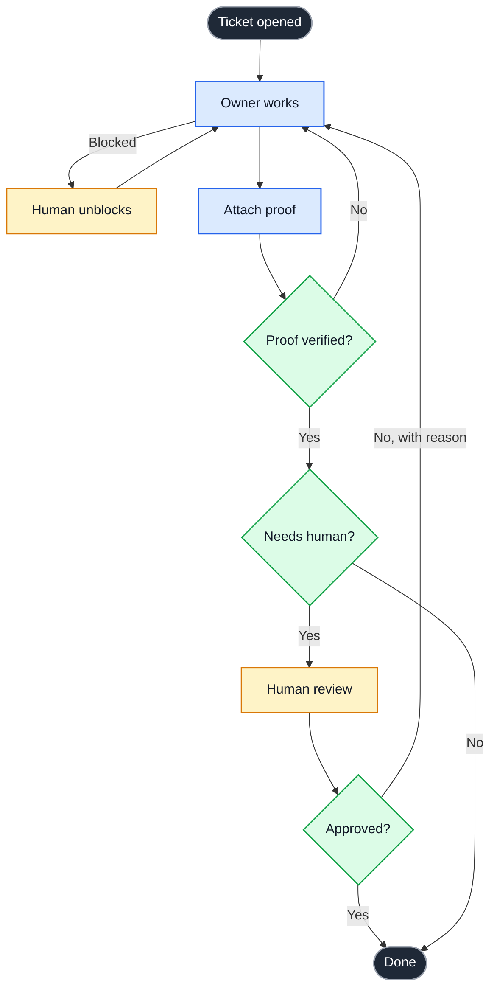

# Governance: H2H

How work is tracked, checked and approved, and how much a harness may do on its own.

## The ticket system

A custom ticket system is the centre of H2H. It does two jobs:

- **Shared record.** Every harness reads it, through the reporting tool, to learn what is done, what is left and what is blocked.
- **Human gate.** The human approves, rejects with a reason, or unblocks a decision.

A ticket carries its description, acceptance criteria, owner, state, attached proof, and the history of approvals and rejections. It also carries the model and effort it should run at, its estimate, and what it actually cost.

The lifecycle below applies in both planning modes. Managed mode adds planning states in front of it; see [planning.md](planning.md).

## Ticket lifecycle

A ticket is done only after its proof is verified and, where the rules require it, a human approves. A rejection always carries a reason and sends the ticket back to its owner.

## Proof of work

A harness saying "done" is a claim. Proof is an artifact that someone else can check without trusting the author:

- A commit reference and test output from a run the author did not control.
- A screenshot or recording of the UI in the stated state.
- A deploy URL that responds.

If another harness or a script can re-run the check, the human only judges whether the work is right, not whether it happened. What counts as proof for each kind of work is declared in the config.

## Approval rules

A human on every ticket becomes the bottleneck. Approval is therefore set by risk:

| Ticket type | Who approves |
|---|---|
| Reversible and machine-checkable, such as a UI change with passing tests | Automatic, on verified proof |
| Judgment calls: wording, design, scope | Human |
| Irreversible or outward-facing: production deploys, customer messages, spending | Human, always |

## Rejections

- A rejection has a reason and an explanation.
- The reason stays on the ticket and is given to the harness on every retry. Without that, the harness repeats the mistake after its session resets.
- Over time, recurring reasons become project rules in the config.

## Autonomy

Autonomy is the main risk of H2H. It is controlled in four ways:

- **Per ticket type.** The approval table above is the autonomy setting. It can be widened as trust builds.
- **Scoped access.** Each owner holds only the credentials and repository access its domain needs, so a wrong decision is contained.
- **Budgets.** Each harness has a budget, enforced by H2H and backed by a pause in the keeper if H2H is unreachable.
- **Round limits.** A build-and-test loop stops after a set number of rounds and escalates to the human.

## Preventing rework

Tickets coordinate intent, and skills given to a harness are instructions. A harness can misread or ignore either, so each cause of rework also has a mechanism in code:

| Cause | What enforces it |
|---|---|
| Two owners edit the same files | Each domain owns a set of paths. A commit that touches files outside them is rejected |
| Two harnesses pick up the same work | One owner per ticket, claimed with a lock |
| One domain changes something another depends on | The interface between domains is a written contract. Changing it is its own ticket and notifies the owners that depend on it |
| Parallel branches conflict when merged | Merges go through a queue: update to the latest version, re-run the tests as proof, then merge |

The first two are prevented outright. The last two cannot be prevented, and the mechanisms keep their cost contained.

## Human intervention

The user can watch any session and step into it; [runtime.md](runtime.md) describes how. Stepping in is governed like any other action:

- **One driver at a time.** While the user is typing in a session, its ticket is on hold and H2H sends it no work.
- **Recorded on the ticket.** The ticket shows that a human took over, when, and when control was handed back.
- **Proof still applies.** Work done by hand goes through the same verification as work done by the harness.

## When the orchestrator is down

Sessions keep running if H2H crashes. During that time no rule is being enforced, so:

- A harness that needs an approval waits, because approvals go through the ticket system.
- Budgets are not enforced. A keeper can be set to pause its harness after a set time without contact.
- On restart, H2H reconciles what each session reported while it was away before assigning anything new.

## Limits on the coordinator

A coordinator harness that can configure other harnesses could grant permissions, including to itself. Three limits apply:

- **It proposes, a human applies.** Config changes from the coordinator are proposals that go through plan and apply.
- **It cannot approve high-risk tickets.** Otherwise it becomes a way around the human gate.
- **It holds no domain credentials.** It coordinates owners and does not do their work.

| Kept in code | Given to the coordinator |
|---|---|
| Ticket states and transitions | Breaking work into tickets |
| Approval rules | Assigning tickets to owners |
| Budgets and their enforcement | Re-planning after rejections |
| Who holds which credentials | Status summaries for the human |

## Intended use

Stated plainly so the system is not used for the wrong job.

**For:**

- Multi-part projects where distinct domains can be owned separately.
- Work whose outcome can be verified.
- Teams where the harnesses differ in strength, tools or access.

**Not for:**

- Single tasks. One agent with tools is cheaper and as good.
- Work with no checkable outcome.
- Two harnesses doing the same job. That adds cost without a second point of view.
