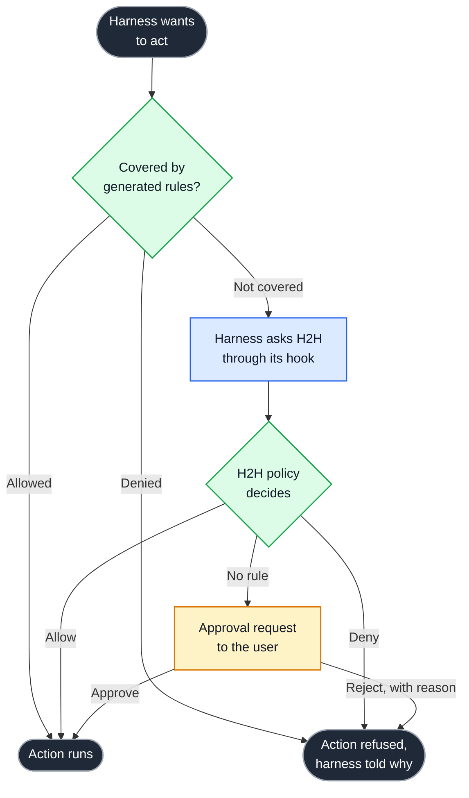

# Permissions: H2H

How H2H answers a harness that stops and asks "may I do this?", so the user does not have to be attached to every session.

## The problem

Every harness asks before it runs a command, edits a file or reaches a URL that its rules do not already allow. In a terminal the user answers. In H2H nobody is watching most sessions, so an unanswered prompt stalls the session and its ticket.

The user's answer is usually predictable: "yes to running the tests", "never push to main". H2H takes those answers once, as config, and applies them on the user's behalf. Anything the config does not cover still goes to the user.

This is separate from who may grant permissions, which is covered in [governance.md](governance.md), and from logins, which are covered in [authentication.md](authentication.md).

## How a request is answered

Most requests are settled by rules the harness enforces itself, and the rest are decided by H2H policy in code. Only a request that no rule covers reaches the user, as an approval request with the same approve or reject flow as a ticket.

## Three layers

### 1. Generated native rules

Each harness has its own permission settings: allow and deny lists for commands, file paths and URLs. H2H writes them from its config when it starts a session.

- **Why first:** the harness enforces these itself, with no round trip to H2H, and they hold even if H2H is down.
- **Limit:** each harness has its own rule syntax and its own gaps, so the H2H config can only express what can be translated for every harness in the pool.

### 2. Policy decisions through a hook

A request that the native rules do not settle is sent to H2H by the harness's own extension point: a hook that runs before a tool is used, or a tool the harness calls to ask for permission. H2H answers allow or deny from its policy, in code, with no model call.

- **Why:** policy can use what only H2H knows, such as the ticket, the domain's paths, the budget left and the risk level of the ticket type.
- **Limit:** depends on each harness having such an extension point. This is the main thing to validate before a build.

### 3. Escalation to the user

A request with no matching rule becomes an approval request. The session waits, the user is notified, and the answer is recorded on the ticket. An answer can be saved as a new rule, so the same question is not asked twice.

## What H2H does not do

H2H does not answer a prompt by typing "y" into the harness's terminal. That would mean reading the screen to know what is being asked, and a misread approves the wrong action. If a harness offers no way to answer in code, its prompts go to the user by attach, and that harness is a poor fit for unattended work.

## What the config declares

Per domain owner, and optionally per ticket type:

| Declared | Example |
|---|---|
| Commands allowed without asking | Run the test suite, read-only git commands |
| Commands always denied | Push to the main branch, delete outside the workspace |
| Paths that may be written | The paths the domain owns |
| URLs that may be reached | The package registry, the project's staging site |
| What happens when no rule matches | Ask the user (default), or deny |

Deny wins over allow. A change to these rules goes through plan and apply like any other config change; see [configuration.md](configuration.md).

## Containment

Automatic approval raises the cost of a wrong rule, so each session also needs a boundary that does not depend on the rules being right:

- **Workspace.** Each session already has its own working copy. That separates files inside the project only.
- **Sandbox.** The session should also be unable to reach the rest of the machine: the home directory, other projects, other sessions' credentials. A container or an operating system sandbox per session is the candidate. Not designed.
- **Network.** Reaching only the declared URLs, enforced outside the harness. Not designed.

The broader the automatic approvals, the stronger the containment has to be. A session with no sandbox should run with narrow rules and ask often.

## Not verified

- Whether every target harness has a hook or permission tool that can answer in code. Claude Code documents both. Copilot's command-line flags cover the first layer, and its support for the second is not checked.
- Whether generated native rules behave the same in a harness's interactive mode as in its non-interactive mode.
- Whether a waiting harness can be told "denied, do this instead" in a way it acts on.

These are the subject of the permission validation in [`../validations/`](../validations/README.md).
