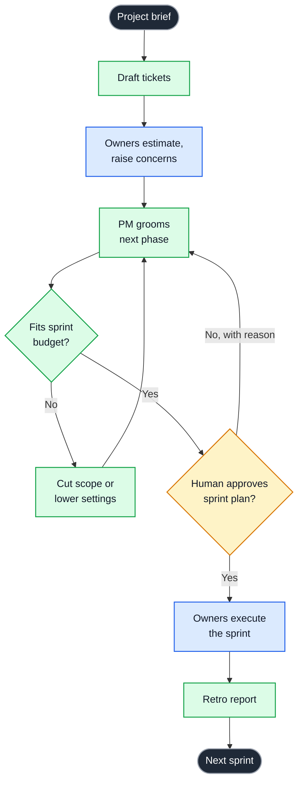

# Planning: H2H

How work is ordered and scheduled. H2H has two modes, chosen in the config.

## Two modes

| | Kanban (default) | Managed (project manager enabled) |
|---|---|---|
| Who creates tickets | The orchestrator | The orchestrator, refined by the project manager |
| Planning | Priority order only | Estimation, grooming, phases and sprints |
| How owners get work | Pull the next ticket by priority | Work the tickets in the current sprint |
| Overhead | Low | A planning round before execution |

Managed mode borrows from agile without copying it. It exists for larger projects, where planning overhead pays for itself. A user who does not need that level of management leaves it off.

### Kanban mode

The orchestrator creates tickets, gives each a priority and a domain, and each owner picks up its tickets one at a time in priority order. An owner has one ticket in progress at a time, so priority order means something.

## Managed mode

Tickets are estimated by the owners who will do them, groomed into a sprint that fits the budget, and approved once by the human before execution. The retro at the end feeds what was learned into the next round of planning.

### The project manager

The project manager (PM) is a role, switched on in the config. It is a small agent flow with code underneath, not a full harness:

| Part of the job | Done by |
|---|---|
| Ordering tickets by dependency, moving ticket states, forming phases | Code |
| Weighing an owner's concerns, spotting missing requirements, reconciling estimates that disagree | A small agent |
| Anything the agent cannot resolve | A harness, as escalation |

**Plan changes go through the PM.** That means scope, estimate, priority and phase. Progress reports and proof still go straight from the owner to the ticket store, so the PM is not a bottleneck for status.

### Estimation

The PM asks each domain owner to estimate its tickets. The owner returns typed fields on the ticket:

- **Cost:** expected tokens or spend.
- **Settings:** the model and effort level the work needs.
- **Risk:** how uncertain the estimate is.
- **Concerns, dependencies and open questions.**

Time is not estimated, because time is not the constraint.

Rules that keep estimation cheap and honest:

- Estimation has a small fixed budget per ticket, since the owner has to investigate to estimate.
- Tickets below a size threshold skip it.
- Every ticket records estimate against actual. Early estimates will be unreliable, and this record is how they improve.

### Planning states

Managed mode adds states in front of the lifecycle in [governance.md](governance.md):

1. Draft
2. Estimating
3. Estimated
4. Groomed
5. Scheduled in a sprint
6. In progress, then proof, review and done

### Phases and grooming

Once tickets are estimated, the PM groups them into phases by dependency. Before a phase is scheduled it is groomed: every requirement and dependency is checked and weighed. Only the next phase is planned in detail. Later phases stay rough, because execution will change them.

### Sprints

A sprint is one round of execution for a groomed set of tickets. It has no deadline. It is bounded by:

- **A budget.** A token or cost ceiling. Reaching it stops the sprint and brings in the human, which is the enforcement a deadline would have provided.
- **A goal with exit criteria.** The sprint ends when its tickets are done and verified.

The sprint boundary is a human checkpoint. Approving a groomed sprint plan once is cheaper than approving every ticket.

Time-bounded sprints are possible later and are out of scope for now.

### Fitting a budget

When the estimate exceeds what the user wants to spend, planning offers a choice instead of downgrading silently:

> This sprint is estimated at $X on the current settings. To fit your $Y budget you can drop these tickets, or lower the settings on these ticket types, which have passed first time 60% of the time at that level against 90% now.

- **The acceptance bar does not move.** A cheaper model must still produce proof that passes verification. Lower settings mostly show up as more rounds or a failed ticket.
- **Some quality is not covered by proof.** Design and code clarity are judgment calls. They can drop with a cheaper model, and the user is told so.
- **Cutting scope is offered alongside cutting quality,** and is often the better choice.

## Retro

At the end of a sprint H2H produces a retro. It is a report, not a meeting.

- **Computed by code:** estimate against actual, rounds needed to pass, rejections and cost per ticket.
- **Explained by owners, for outliers only:** when a ticket ran far over its estimate, its owner is asked why. The answer becomes a note in the owner's domain map or a proposed config change.
- **Reviewed by the human,** who accepts or declines the proposals.

Agents do not rate the sprint. A model's opinion of its own work is a weaker signal than the numbers, and it costs tokens.

### Using retro data for model and effort

Tickets are grouped by domain, phase and a type label, and compared within the group.

- Suggestions wait until a group has enough history.
- The number that matters is cost per approved ticket. A cheaper model that needs three rounds can cost more than a stronger one that passes first time.
- Changes start as suggestions. Automatic adjustment comes later and goes through plan and apply.

### Sprint metrics

All computed by code:

| Metric | Shows |
|---|---|
| Spend against the sprint budget | Burn rate over the sprint |
| Cost per completed ticket | The nearest equivalent to velocity |
| Planning share | How much went to estimation and grooming, against execution |
| Rework share | How much was spent after a first rejection |
| Estimate accuracy | How far actuals were from estimates, by ticket type |

Planning share and rework share tell a user whether managed mode is paying for itself.

## Risks

- **Plans go stale.** A ticket whose actual cost passes its estimate by a set margin is flagged back to the PM.
- **Over-planning.** Detailed planning of far-off work is wasted, which is why only the next phase is groomed.
- **Ceremony cost.** Planning cost is recorded separately from execution cost so it stays visible.

## Staging

1. Record the data and show the retro report. No agents involved.
2. Suggestions for model and effort, and the budget choice at planning.
3. Automatic adjustment.
