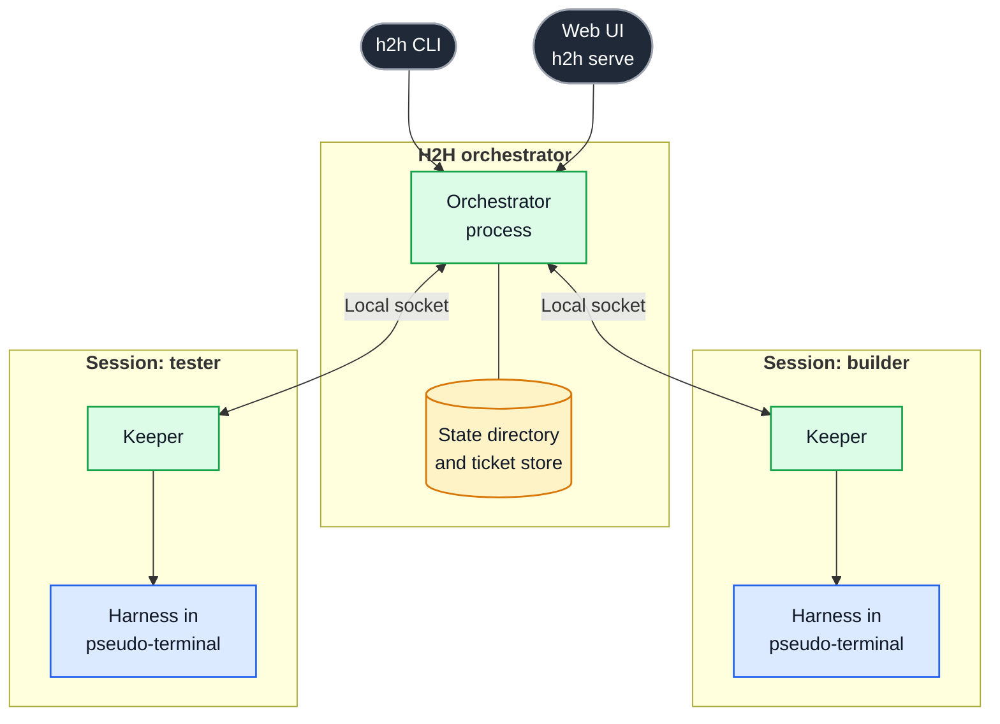
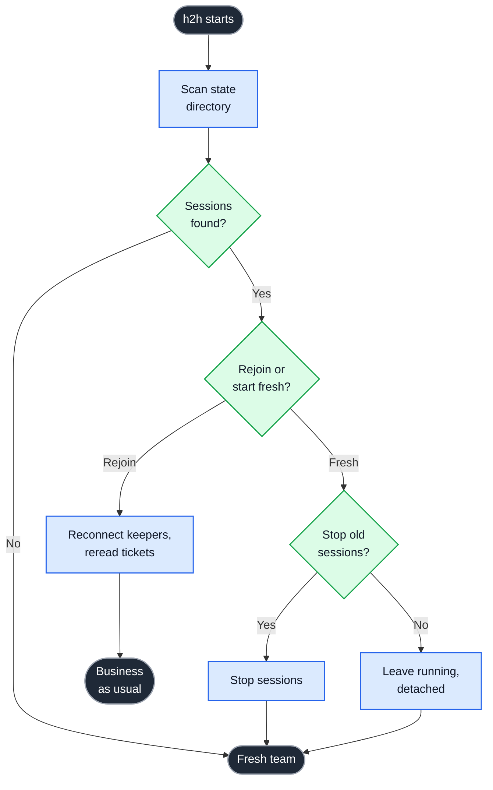

# Runtime: H2H

How H2H runs harnesses as processes: sessions, workspaces, monitoring, jumping in, and surviving a crash.

## Role

H2H is a harness supervisor as well as a coordinator. It starts each harness, gives it a workspace, tracks its session, keeps its logs, and lets the user watch or step into it. The closest comparisons are tmux for the sessions and Docker for the listing, logs and "open a terminal inside it" experience.

## Process model

Each harness runs under its own keeper process, which is independent of the orchestrator and records its state on disk. The orchestrator talks to keepers over local sockets, so it can stop and start again without disturbing a running harness.

### Orchestrator

The process that applies the rules: it assigns tickets, enforces approvals and budgets, and serves the CLI and the web UI. It holds no state that exists only in memory. Everything it needs is in the state directory and the ticket store.

### Keeper

A small process that sits between H2H and one harness. Docker calls the equivalent a shim.

- **Owns the harness.** It holds the pseudo-terminal and the harness process. It is detached from the orchestrator, so an orchestrator crash does not affect it.
- **Records state on disk.** Session ID, workspace path, ticket, status, exit code and the terminal log.
- **Offers a socket for attaching** to the terminal.
- **Stays tiny.** If a keeper dies, its harness dies with it, so the keeper does nothing beyond holding the terminal and writing state.

The keeper is the `h2h` binary started in an internal mode, so there is still only one file to ship.

### State directory

One entry per session, written by its keeper, plus the ticket store (for example SQLite). Because listing, logs and attaching read from here and from the keepers' sockets, they keep working even when the orchestrator is not running.

## Sessions and workspaces

- **Session.** One running harness with its own history. H2H records the harness's own session ID so the session can be resumed later.
- **Workspace.** Each session gets its own working copy, for example a git worktree, so two sessions never edit the same files. H2H creates it when the session starts and removes or archives it when the session ends.
- **Trusted workspace.** A harness asks before working in a folder it has not been told to trust, and an unanswered question stalls the session before it starts. See [Workspace trust](#workspace-trust).
- **The same harness twice.** Two sessions of one product are two keepers with separate workspaces and histories.

## Workspace trust

The first time a harness runs in a folder, it asks the user whether to trust it and records the answer. H2H creates a new workspace for every session, so without a plan every session would stop at that question.

### One behaviour for every harness

A session behaves the same whichever harness runs in it: the same kind of workspace, the same way of getting trust, the same way of getting hooks. Where a harness cannot do what the others do, H2H looks for a different mechanism that gives the same result before it accepts a difference. A difference that remains is declared in the config per harness, never hidden in code.

### How each harness handles trust

| | Claude Code | Copilot CLI | Codex CLI |
|---|---|---|---|
| Trust is attached to | The git repository root. A worktree counts as its main checkout. A nested repository is separate | A folder | A project folder |
| Covers subfolders | Yes, except nested repositories | Yes | Yes for a subfolder of a trusted repository (observed) |
| Recorded in | `~/.claude.json`, per project path | `trustedFolders` in `~/.copilot/config.json` | `trust_level` per project in `~/.codex/config.toml` |
| Supported way to grant it without the dialog | None for interactive sessions | `--trust-folder`, for one non-interactive run only | `codex exec --trust`, which saves it (not tested) |
| Without a terminal (`-p`, `exec`) | No dialog is shown | Skips the folder's hooks and MCP servers unless `--trust-folder` is given | Not tested |

Sources: each harness's documentation and help text, and the validation spikes. A per-launch config override did not remove Codex's dialog when tested.

### The workspace model

Every session, for every harness, gets a git worktree of the project, kept in one folder inside the project such as `.h2h/workspaces/`. Tested with all three:

| In a worktree of the project | Claude Code | Copilot CLI | Codex CLI |
|---|---|---|---|
| Starts without a trust dialog, when the project is already trusted | Yes | Expected from its subfolder rule. Not confirmed, because the test project was not trusted in Copilot | Yes |
| Hooks given at launch, with no file in the workspace | Yes, with `--settings` | No | Yes, as config overrides |
| Hooks read from a file in the worktree | Works, but triggers the trust dialog | Yes, from `.github/hooks/` | No. The file was ignored |
| Completed the test task with state reported throughout | Yes | Yes | Yes |

So the worktree model holds for all three, and trust and hooks are handled as follows.

**Trust: inherit what the user has already given.** Because workspaces sit inside the project, a project the user has trusted in a harness covers them. H2H gives no consent on the user's behalf. Where a harness does not yet trust the project, `h2h` checks before starting any session and tells the user, who consents once through the harness's own dialog or documented command.

**Hooks: given at launch wherever possible.** Claude Code and Codex take hooks as launch arguments, so nothing is written into the workspace. Copilot is the exception: it reads hooks only from files. Two ways to close that gap, neither chosen yet:

| Option for Copilot | Effect | Cost |
|---|---|---|
| A hooks file in each worktree, excluded from git | Same result as the others, per session | A file H2H must create, keep out of commits and remove |
| Hooks installed once in Copilot's user folder, active only inside an H2H session | Nothing in any workspace | Changes the user's own Copilot setup, so it needs their consent at install |

H2H does not write trust into a harness's own config files. Claude Code documents its trust entry only as something a person may edit by hand, and a tool writing to a file the harness also writes can corrupt it.

Rules that follow:

- **No fresh repository per session.** A new `git init` is its own trust root in Claude Code, and asked every time in the spikes.
- **Trust is not permission.** Trusting a workspace lets the harness load its settings. What the harness may then do is decided by [permissions.md](permissions.md).

### Per-harness settings in the config

Where harnesses still differ, the user's config says how H2H treats each one. The defaults are the same for all, and an entry is only needed to depart from them:

| Setting | Default | Example of a departure |
|---|---|---|
| Workspace kind | Worktree inside the project | A plain subfolder, for a harness that mishandles worktrees |
| How trust is obtained | Inherited from the project | Ask the user at first start |
| How hooks are delivered | At launch | A file in the workspace, for Copilot |
| Extra launch arguments | None | A sandbox mode for Codex |

The schema is not designed; see [configuration.md](configuration.md).

### Not settled

- **Which option for Copilot's hooks.**
- **Copilot trust in a worktree.** Expected to follow its documented subfolder rule, and to be confirmed in a project Copilot already trusts.
- **A project the user never opened in a harness.** The first run then needs the user present, once per harness.
- **Trust scope.** Trusting the project also trusts whatever settings the repository carries, for every session. That is the user's existing decision, but H2H makes it apply to unattended runs.
- **Codex's hook review.** Codex wants each hook reviewed by the user. The spikes skipped that with a flag meant for automation. Whether H2H should use that flag or have the user review H2H's hooks once is open.

## How H2H and a harness communicate

Reading a harness's status off its terminal screen is fragile, so H2H never does that. The harness tells H2H instead, in two ways.

| Direction | Channel |
|---|---|
| Work into the harness | The prompt when the session starts, and text typed into its terminal |
| State out of the harness | The harness's own hooks: session started, prompt accepted, tool started and finished, permission needed, turn finished, session ended. H2H configures them when it starts the session |
| Content out of the harness | A reporting tool that H2H provides, as an `h2h` command or an MCP server. The harness calls it to say "ticket done, here is the proof" or "blocked, need a decision" |
| People | The terminal, for watching and jumping in |

Hooks fire whether or not the model remembers to report, so they carry the state. The reporting tool carries what only the model knows. The validation spikes confirmed both on Claude Code, Copilot CLI and Codex CLI; see [findings.md](findings.md).

The requirement for a harness to join a team is: it runs in a terminal, it has lifecycle hooks, and it can call a tool.

### Session states

| State | Decided by |
|---|---|
| Working | A prompt or tool event from the harness's hooks |
| Waiting for a permission answer | A permission request held by H2H; see [permissions.md](permissions.md) |
| Idle | The turn-finished hook |
| Hung | No hook event and no terminal activity for a set time while working. Only the presence of terminal bytes is used, never their content |
| Exited | The process ending |

Two cautions from the spikes:

- **Idle is not done.** A harness can end its turn with a command still running in the background. A ticket is done on a report and verified proof, never on the turn ending.
- **Exit is not the only end.** A harness run without a terminal can finish its work and stay alive. Every run has a time limit.

### Harness adapters

Hook names, where hooks are configured, command-line flags, the trust mechanism and the permission model all differ between harnesses. Each harness product has a small adapter that hides this from the rest of H2H:

- How to start the harness, and with which flags.
- How to configure its hooks, and how its event names map to the states above.
- How to make a workspace trusted.
- Standing instructions the harness needs, such as following instructions in a refusal.
- How its usage is reported.

An adapter has a conformance test, run when the harness version changes.

## Monitoring and jumping in

| Mode | What the user gets | When |
|---|---|---|
| Watch | The live terminal and log of a session, read-only | Monitoring |
| Attach | The user types into the harness's terminal, as with tmux | Intervening in a running session |
| Take over | H2H pauses the session, the user works in the harness's own interactive CLI on the same session and workspace, then hands it back | Longer manual work. Depends on the harness supporting resume by session ID |

Attach is the main path. Two rules apply to all three:

- **One driver at a time.** A session is driven by H2H or by the user, never both. Attaching to type puts the session's ticket on hold until the user releases it.
- **Interventions are recorded** on the ticket, so the record of who did what stays accurate.

## Crash recovery

On start, H2H looks for sessions that outlived the previous run and lets the user rejoin them or begin again. Rejoining needs nothing from the harnesses, because they never stopped.

When scanning, H2H sorts each session into one of three groups:

- **Running:** the keeper answers on its socket.
- **Exited while H2H was down:** the keeper recorded an exit code and whatever the harness last reported.
- **Stale:** state on disk with no live keeper, to be cleaned up.

What this does not cover:

- **A reboot.** Processes die with the machine. Recovery then depends on each harness resuming by session ID.
- **Spending while the orchestrator is down.** Harnesses keep working with nobody enforcing budgets. A keeper can be set to pause its harness when it has not heard from the orchestrator for a set time.
- **A keeper crash.** Its harness is lost, which is why the keeper is kept minimal.

## Interfaces

H2H is a command-line tool first. The web UI is the same tool started with a flag.

| Command (names not final) | Does |
|---|---|
| `h2h` | Starts or rejoins a team |
| `h2h ps` | Lists active sessions with harness, domain, ticket and state |
| `h2h logs -f <session>` | Follows one session's log |
| `h2h attach <session>` | Opens the session's terminal |
| `h2h serve --port <n>` | Serves the web UI, including a terminal in the browser for each session |

The web UI offers what the CLI does, plus the ticket board and proof viewer described in [configuration.md](configuration.md). A terminal in the browser is a remote shell with the harness's permissions; see [authentication.md](authentication.md).

## Implementation

**Language: Go.**

- **Single file.** Go compiles to one self-contained executable, with the web UI's files embedded in it, and cross-compiles for other systems from one machine.
- **Fits the work.** H2H supervises processes and relays streams. Its speed is set by the models, which take seconds to minutes, so a faster language would not show.
- **Established for this shape of tool.** Docker, Kubernetes and the GitHub CLI are written in Go.
- **Few dependencies needed.** The standard library covers most of what H2H does, which keeps the licence audit in [licensing.md](licensing.md) short.

Rust would also work and also ships as one file. It was set aside because its speed advantage does not matter here and development is slower.

**What a compiled binary protects.** It contains no source code, which stops casual inspection. It is not opaque:

- Function names, file paths and text strings are readable by default. Build flags that strip debug information and paths, and an obfuscating build tool, reduce this.
- A determined person can still reverse-engineer the logic. No secrets go in the binary.

**Platforms.** macOS and Linux first. Pseudo-terminals and local sockets work differently on Windows.
